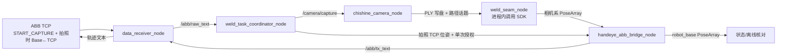

# 华南理工大学智能焊接实验室 · x86 ROS 2 工作区

> Ubuntu 22.04 · ROS 2 Humble · Chishine 3D 相机 · 波纹板焊缝识别 · 手眼变换 · ABB TCP

本仓库的当前主线任务是：收到 ABB 的拍照位姿，采集点云，提取焊接轨迹，把相机坐标系下的位姿转换到机器人基坐标系，再将轨迹发回 ABB。焊机、电机和第三方焊接决策代码仍保留在仓库中，**不属于当前总 launch 的运行链路**。

> [!WARNING]
> 本工程可连接真实机器人。`send_to_abb=true` 表示会向 ABB socket 发送轨迹；是否存点、规划或运动由 ABB 端程序决定。离线预览、编译通过、socket 发送成功、ABB ACK，都不能证明机器人可达或焊接安全。首次现场验证须由现场人员确认安全模式、禁弧、低速和单点检查。

## 从这里开始

| 我想做什么 | 阅读位置 |
| --- | --- |
| 启动人工 ROI/参数复核，再连续处理 ABB 请求 | [人工标定与自动运行](src/cimc/人工标定与自动运行.md) |
| 固定夹具、不打开标定窗口直接运行 | [实际启动与分节点测试手册](实际启动与分节点测试手册.md) |
| 查节点、话题、QoS 和数据单位 | [ROS 2 节点与接口](ROS2全部节点与接口说明.md) |
| 调焊缝 ROI、角点、姿态与偏移 | [焊缝节点说明](src/weld_seam_perception/README.md) · [当前 YAML](src/weld_seam_perception/config/weld_seam.yaml) |
| 查算法 C++、SDK 构建或独立 PLY 测试 | [工作区内算法源码](x86_weld_seam_test/README.md) |
| 查相机参数和实时 ROI 查看器 | [相机 ROS 包](src/chishine_camera_ros2/README.md) · [实时查看器](x86_chishine_live_viewer/README.md) |
| 查 ABB/手眼实现与第三方历史接口 | [cimc 包](src/cimc/README.md) · [第三方协议](第三方焊接通信协议.md) |

## 当前运行链路



运行阶段是 **5 个核心 ROS 节点**。人工模式确认后默认还会打开 1 个只读状态窗进程；标定窗口本身不是 ROS 节点。固定模式沿用旧 ABB launch，不打开该状态窗。默认不开多个 `ros2 topic echo` 调试进程，也不启动 `weld_controller_node`、`motor_control_node` 或旧 `weld_logic_node`。`data_receiver.yaml` 中 `third_party_link_enabled=false`，因此 192.168.3.5 通道不连接。

相机与算法之间的 ROS 消息是 **PLY 文件绝对路径**，不是完整点云；大点云经磁盘传递。焊缝 CSV/PLY 的 XYZ 为相机系 mm，ROS `PoseArray` 位置为 m，四元数按 ROS 字段 `x,y,z,w`；ABB 轨迹文本使用 mm 与 `qw,qx,qy,qz`。具体帧、矩阵方向和 topic 见[接口说明](ROS2全部节点与接口说明.md)。

## 两种正常启动方式

先在新终端加载环境，并确保实时相机查看器已经退出、ABB 程序处于现场确认的安全调试模式：

```bash
source /opt/ros/humble/setup.bash
source /home/mini/x86_ros2_ws/install/setup.bash
```

| 模式 | 命令 | 用途 |
| --- | --- | --- |
| 人工复核（默认） | `ros2 launch cimc camera_weld_operator_abb.launch.py` | 可选历史 PLY 或实时相机 ROI；预览后确认配置，之后连续处理 ABB 请求 |
| 固定夹具 | `ros2 launch cimc camera_weld_operator_abb.launch.py workflow_mode:=fixed` | 直接使用已确认的 YAML，不打开标定窗口 |
| 旧的无 ABB 输出测试 | `ros2 launch cimc camera_weld_handeye_test.launch.py` | 仅在其独立安全配置满足预检时使用；不是当前 ABB 主链路 |

总 launch 默认 `echo_topics:=false`、`show_operator_status:=true`、`use_shared_memory:=true`。`show_operator_status` 仅对人工模式有效；需要终端逐话题日志可设 `echo_topics:=true`。Fast DDS 的 `DEFAULT` 传输使同机节点优先使用 SHM，并保留 UDPv4 发现/回退；若现场有 DDS 兼容问题，用 `use_shared_memory:=false` 继承原有环境。**不是 SHM-only，也不是点云零拷贝。**

人工模式会先开启 ABB TCP 监听，再等待操作员确认；确认前的 `START_CAPTURE` 不会排队执行。固定模式或直接运行旧 ABB launch 不提供这一人工确认关口。详细操作与安全条件见[人工标定说明](src/cimc/人工标定与自动运行.md)。

## 参数在哪里生效

现场可调的相机、算法、手眼和网络参数来自以下 **`src` 下的配置文件**，launch 不另写一套这些参数。唯一的运行门禁例外是人工模式向 ABB 接收节点传入 `hold_capture_until_coordinator_ready=true`，确保人工确认前拒绝请求。改 YAML 后重新启动相应节点或 launch 即可；改 C++/Python 或 SDK 源码则必须重新构建。

| 模块 | 唯一现场配置入口 | 重点 |
| --- | --- | --- |
| 相机 | [`src/chishine_camera_ros2/config/camera.yaml`](src/chishine_camera_ros2/config/camera.yaml) | 深度范围、增益、曝光、帧时间、采集有效率 |
| 焊缝 | [`src/weld_seam_perception/config/weld_seam.yaml`](src/weld_seam_perception/config/weld_seam.yaml) | `algorithm_overrides` 中的 ROI、`path.mode`、角点姿态和偏移 |
| 手眼 | [`src/cimc/config/handeye_bridge.yaml`](src/cimc/config/handeye_bridge.yaml) | 矩阵文件路径、键名、方向、单位、`send_to_abb` |
| 协调 | [`src/cimc/config/weld_task_coordinator.yaml`](src/cimc/config/weld_task_coordinator.yaml) | 拍照命令、TCP 位姿单位、任务同步 |
| ABB TCP | [`src/cimc/config/data_receiver.yaml`](src/cimc/config/data_receiver.yaml) | 本机监听地址、ABB 来源 IP、第三方通道开关 |

当前焊缝 YAML 使用 `path.mode=rounded_features`，且已启用特定拍照位置的 X/Y ROI 和分类偏移；**不能把它当作所有工件、所有拍照位的通用参数**。`feature_points` 是旧单角点模式，`adaptive_contour` 是备用模式。三种模式输出接口相同，但点数、姿态和可达性均须分别检查。

## 构建与算法版本

ROS 适配包 `weld_seam_perception` 直接链接工作区内 `x86_weld_seam_test/install` 的 SDK，见其 [`CMakeLists.txt`](src/weld_seam_perception/CMakeLists.txt)。它**不**从外部 `~/scut_weld_sdk_install` 自动取当前库。工作区算法源码的 CMake 版本与已安装 `.so` 可能不同；以节点启动日志的 `Weld seam SDK ... ready` 和工作区 SDK 安装目录中的库为实际运行依据。修改算法源码仅编辑文件而未重新安装 SDK、重建 ROS 包，现场运行结果不会随之变化。

日常仅构建受影响的包，例如：

```bash
cd /home/mini/x86_ros2_ws
source /opt/ros/humble/setup.bash
colcon build --packages-select cimc --base-paths src
source install/setup.bash
```

算法 SDK 的独立构建、安装和离线回归命令见[算法源码 README](x86_weld_seam_test/README.md)。另有独立 Git 仓库 `/home/mini/x86_weld_seam_test`，与本工作区 Git 仓库不是同一个仓库；修改前先确认正在编辑哪一份源码。不要为了刷新配置而删除整个 `build/`、`install/` 或 `log/`。

## 不连接硬件时如何检查

优先在独立 `ROS_DOMAIN_ID` 中只启动 `weld_seam_node`，向 `/camera/pointcloud_file` 发送历史 PLY 的绝对路径；这种测试不需要相机、ABB、焊机或电机，但**不要同时启动总 launch**。结果写入配置的 `output_directory`，重复输入会覆盖同名前缀结果。完整双终端命令已写在[焊缝 YAML 顶部注释](src/weld_seam_perception/config/weld_seam.yaml)和[测试手册](实际启动与分节点测试手册.md)。

主要观测：`/weld_task/status`、`/weld_seam/status`、`/handeye_bridge/status`、`/abb/raw_text`、`/abb/tx_status`、`/abb/task_timing`。`/abb/tx_text` 是准备发送的文本；`/abb/tx_status` 的 OK 仅表明本机 socket 写入；`TRAJECTORY_ACK` 才是 ABB 应用层确认，仍不代表机器人已运动。端到端计时从收到完整 `START_CAPTURE` 到轨迹 `sendall()` 返回，不含 ABB 端解析/执行。

## 文档维护约定

- 根 README 说明**当前主链路**；[测试手册](实际启动与分节点测试手册.md)放可复制操作步骤；[接口说明](ROS2全部节点与接口说明.md)放 topic/单位/QoS；包内 README 放实现边界和参数。
- `order.txt` 是现场命令备忘，可能含特定设备地址、ROI 或历史测试命令；不能代替上面的安全说明。
- 第三方焊接协议、焊机、电机和 SDK 历史备份属于保留资料，默认不在当前总 launch 中启用。变更默认启动行为时，请同步更新上述文档，不要把历史试验结论写成当前保证。
